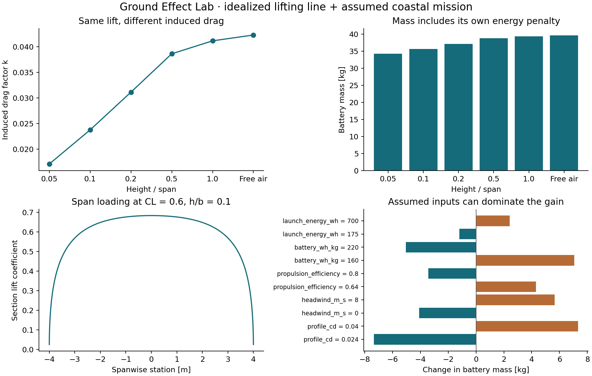

# Ground Effect Lab

A spanwise lifting-line solver and battery-mass sizing study for an electric
surface-skimming craft. The question is how much an induced-drag reduction
actually helps once the rest of the drag and the battery's own mass are included.



For the assumed 60 km mission, the h/b = 0.1 calculation reduces induced drag
by **43.8%** at fixed lift, but battery mass by **10.2%**: **35.58 kg versus
39.63 kg** in free air. Non-induced drag and energy allowances account for much
of the difference. [Calculation and limits](results/report.md).

## Run it

Python 3.10+; the numerical core requires NumPy. The report also needs Matplotlib.

```sh
python3 -m venv .venv
. .venv/bin/activate
python -m pip install -r requirements-tested.txt
python -m pip install -e .
make test
make study
```

The study can also run without installing the package: `python examples/study.py`.
It resolves input and output paths from the script, so another working directory
does not change the result. Edit [coastal.json](examples/coastal.json) to change
the mission; the input hash is recorded in the report.

## What is calculated

- Cosine-spaced span panels carry constant bound circulation and straight
  semi-infinite trailing vortices. An opposite-sign image system imposes an
  impermeable horizontal plane. Section lift compatibility determines circulation.
- A fixed-CL sweep keeps lift comparable across heights. Integrating circulation
  and downwash gives lift and induced drag; profile drag stays explicit.
- An algebraic battery-mass closure includes cruise time, headwind, propulsion
  efficiency, pack energy density, hotel load, reserve time and launch energy.
  It reports infeasibility rather than selecting a convenient battery mass.
- Separate motor, gross-mass and assumed CL screens follow the mass solve.
  Sensitivities vary drag, headwind, efficiency, pack Wh/kg and launch energy.

The [model note](docs/model.md) gives equations, units and the lower-root choice.
[Verification](docs/verification.md) distinguishes analytical agreement from
physical validation. CSV outputs include the height sweep, mesh study and
one-at-a-time sensitivity cases.

## Scope

This is a low-order, inviscid, steady lifting-line calculation with an assumed
section slope. A slip plane is not a moving water surface. It omits chordwise
ground-effect changes, separation, hull drag, propeller interactions, waves and
pitch/heave dynamics. Very small height/chord needs a different model. The
launch-energy input does not establish takeoff-power feasibility.

No craft, battery pack or physical test is represented by the example values.
The useful next comparison is measured fixed-lift drag across heights, followed
by free-surface and longitudinal-stability work.

MIT licensed. [Technical review](docs/review.md).
